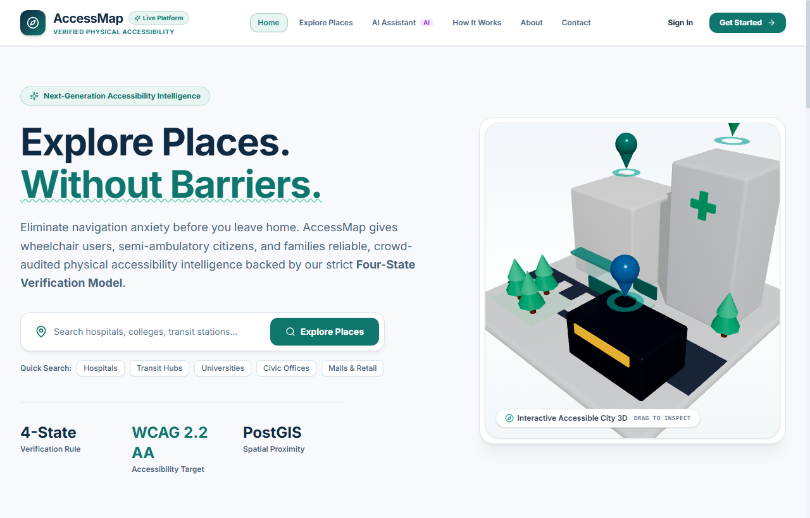
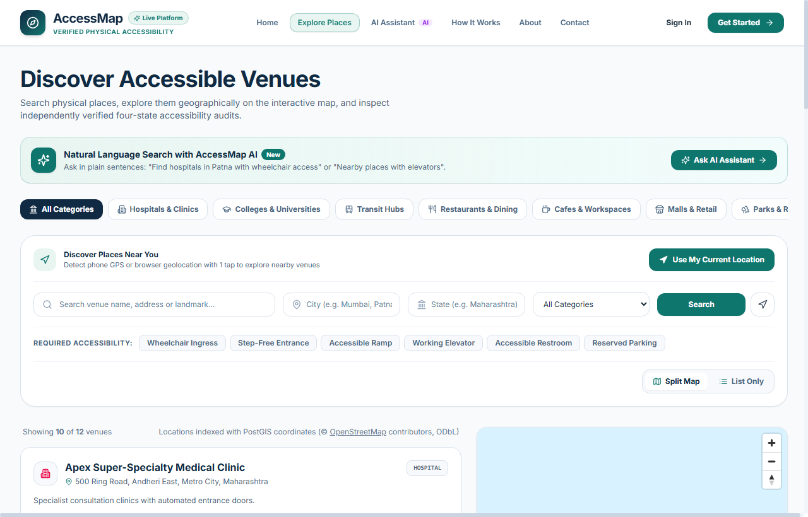
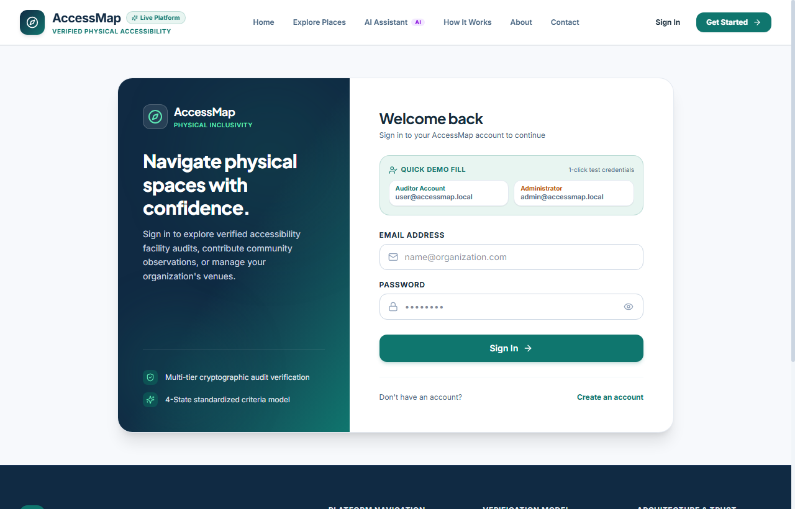
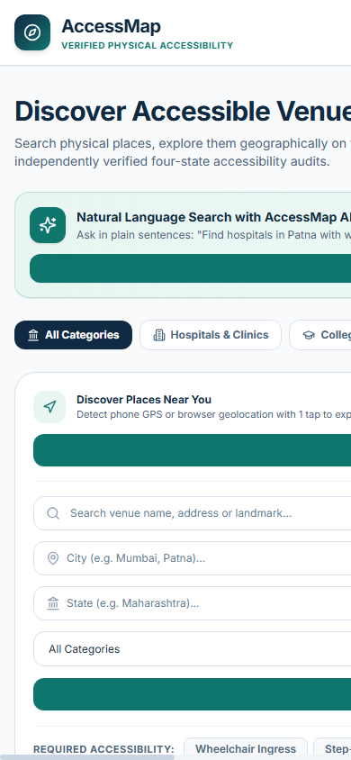
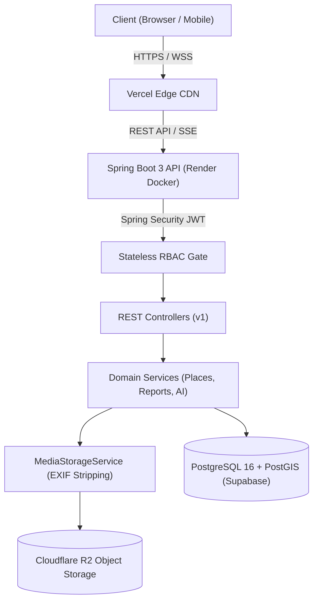
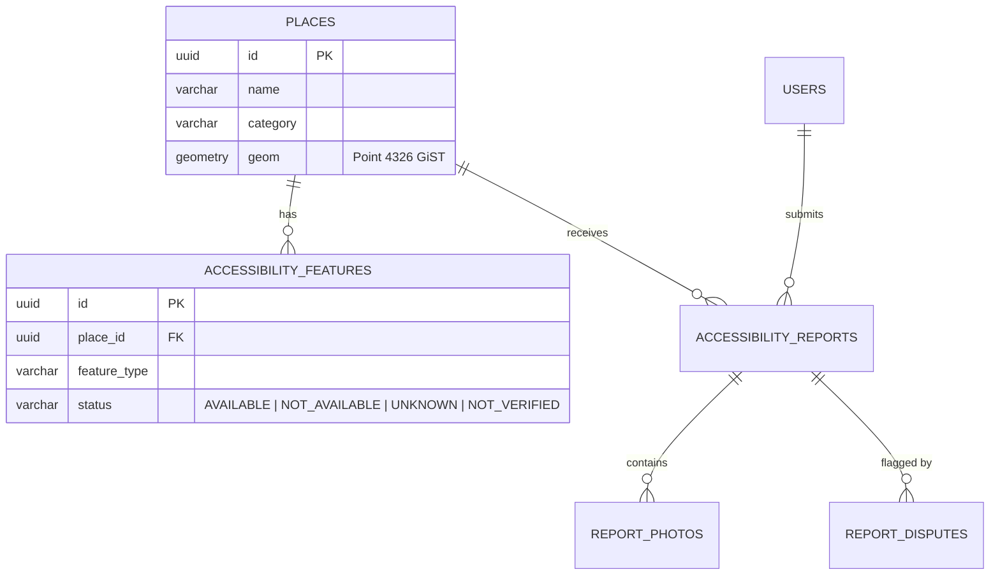

# 🗺️ AccessMap: Intelligent Physical Accessibility Discovery & Verification Platform

> **Eliminating physical accessibility uncertainty through verifiable geospatial intelligence, community auditing, and 3D architectural spatial cutaways.**

[](https://github.com/fraaznasim12/WAYZA-Smart-Nearby-Discovery-Implementation/actions/workflows/ci.yml)
[](docs/PROJECT_RULES.md)
[](frontend/)
[](backend/)
[](docs/DATABASE.md)
[](backend/)

---

## 1. Project Overview

**AccessMap** is an enterprise-grade, full-stack geospatial platform engineered to map and verify physical accessibility infrastructure across real-world venues, including hospitals, universities, transit hubs, restaurants, and civic centers.

Unlike standard commercial directories that treat accessibility as an ambiguous binary boolean (`wheelchair_accessible: true/false`), AccessMap implements a domain-driven **Four-State Verification Model**, pairs interactive vector mapping with **Three.js 3D architectural spatial cutaways**, and provides an immutable community audit trail with tamper-resistant photo evidence.

---

## 2. Real-World Problem Statement

For over 1 billion people worldwide living with mobility impairments—including wheelchair users, elderly citizens, injured individuals, and parents with strollers—navigating cities involves constant physical friction:
- **Binary Fallacies:** A venue labeled "accessible" might have a ramp at the entrance but no accessible restroom or an out-of-order elevator.
- **Stale & Unverified Data:** Physical access changes dynamically due to construction, broken lifts, or blocked pathways.
- **Visual Ambiguity:** Photos of venues rarely focus on entry thresholds, door widths, or slope inclines, forcing individuals to risk travel without certainty.

---

## 3. Our Solution

AccessMap replaces uncertainty with verifiable truth through:
1. **Four-State Verification:** Every architectural feature is audited as `AVAILABLE`, `NOT_AVAILABLE`, `UNKNOWN`, or `NOT_VERIFIED`.
2. **Sub-50ms Geospatial Discovery:** PostGIS spatial queries (`ST_DWithin`) with GiST indexes calculate true geodetic spherical distances.
3. **One-Touch Phone Location Detection:** Automatically detects device GPS coordinates over HTTPS, re-centering maps and loading nearby accessible places instantly.
4. **Purposeful 3D Micro-Visualizations:** 3D isometric cutaways illustrate complex multi-floor accessible paths, pairing with an accessible 2D SVG fallback.
5. **Community Audits & Dispute Queues:** Peer verification and moderation workflows allow facility owners and local auditors to keep data fresh.

---

## 4. Key Features

- **Interactive Vector Spatial Map:** Built with MapLibre GL JS, featuring custom accessible markers, category filters, and live viewport sync.
- **Real-Time Phone Geolocation:** Native browser Geolocation API integration with permission recovery, accuracy circles, and fallback search.
- **Custom Mobility Profiles:** Users configure personalized accessibility requirements (e.g. wheelchair, visual, stroller) that automatically filter venues.
- **3D Spatial Cutaways:** Three.js / React Three Fiber interactive models visualizing multi-floor ingress, ramp gradients, and elevator positions.
- **Community Field Audits:** Registered users can submit accessibility updates with multi-photo evidence and location notes.
- **Secure Image Sanitization:** Automatic stripping of EXIF GPS metadata and image transcoding to safeguard user privacy.
- **Real-Time Server-Sent Events (SSE):** Instant notifications when reports are peer-verified or community disputes are resolved.
- **Facility Claim & Business Dashboard:** Business owners can claim venue listings, post official updates, and respond to community feedback.
- **Comprehensive Admin Suite:** Moderation queues, user role management, system metrics, and immutable audit logs.

---

## 5. Application Screenshots

### Desktop Experience
| Landing & 3D Hero | Interactive Map & Nearby Discovery |
| :---: | :---: |
|  |  |

| User Dashboard & Mobility Profile | Business Facility Portal |
| :---: | :---: |
|  |  |

### Mobile & Administrative Workflows
| Mobile Phone Location Experience | Admin Dashboard & Moderation |
| :---: | :---: |
|  |  |

---

## 6. Technology Stack

| Layer | Technology | Details & Purpose |
| :--- | :--- | :--- |
| **Frontend Framework** | React 18 + TypeScript | Component-based client runtime with strict type safety |
| **Build Tooling** | Vite 6 | Rapid Hot Module Replacement (HMR) and optimized rollup production bundles |
| **Styling & UI** | Tailwind CSS v4 + Lucide React | High-contrast design tokens compliant with WCAG 2.1 AA |
| **Mapping Engine** | MapLibre GL JS | Open-source client-side vector tile spatial rendering |
| **3D Graphics** | Three.js + React Three Fiber + Drei | Interactive spatial architectural cutaways with 2D SVG fallback |
| **Backend Framework** | Java 21 + Spring Boot 3.4.2 | High-throughput enterprise modular monolith REST API |
| **Security & Auth** | Spring Security 6 + JWT | Stateless HMAC-SHA256 bearer tokens and 4-tier RBAC |
| **Database & GIS** | PostgreSQL 16 + PostGIS 3.4 | Spatial point geometries (`Point 4326`), GiST indexes, `ST_DWithin` queries |
| **Database Migrations**| Flyway | Versioned database migrations (V1 through V13) |
| **Object Storage** | Cloudflare R2 / MinIO | S3-compatible zero-egress object storage for EXIF-sanitized evidence photos |
| **Monitoring** | Spring Boot Actuator | Health, liveness, and readiness probes |

---

## 7. System Architecture



*For comprehensive architecture documentation, see [docs/ARCHITECTURE.md](docs/ARCHITECTURE.md).*

---

## 8. Database & Spatial Architecture

Venues are indexed spatially using PostGIS `geometry(Point, 4326)`. Sub-50ms proximity queries are executed natively on the database sphere:



*For complete database schema and entity details, see [docs/DATABASE.md](docs/DATABASE.md).*

---

## 9. How the Application Works

1. **User Discovery:** A user navigates to the Explore page. Clicking **"Use My Current Location"** triggers the browser Geolocation API.
2. **Spatial Calculation:** Coordinates are passed to `/api/v1/places/nearby`. The backend executes a PostGIS `ST_DWithin` spatial query to retrieve venues within the requested radius.
3. **Four-State Inspection:** Each venue displays verified feature badges (step-free entrance, ramp, elevator, restroom).
4. **Community Verification:** Users can submit fresh observations with photos. Photos are stripped of EXIF coordinates on the server before storage in Cloudflare R2.
5. **Real-Time Notification:** When an auditor or admin verifies a report, an SSE event pushes the update to active clients instantly.

---

## 10. Local Installation & Setup

### Prerequisites
- **Java Development Kit (JDK):** Version 21 (Eclipse Temurin or OpenJDK)
- **Node.js:** v18+ and npm v9+
- **Docker:** Optional (local PostgreSQL/PostGIS)

### 1. Clone the Repository
```bash
git clone https://github.com/fraaznasim12/WAYZA-Smart-Nearby-Discovery-Implementation.git AccessMap
cd AccessMap
```

### 2. Backend Setup
The backend runs out-of-the-box using the `dev` profile with spatial H2GIS support:
```bash
cd backend
# Run test suite
.\mvnw.cmd clean test

# Start backend server
.\mvnw.cmd spring-boot:run -Dspring-boot.run.profiles=dev
```
The API starts at `http://localhost:8080`.

### 3. Frontend Setup
```bash
cd ../frontend
npm install
npm run dev
```
Open `http://localhost:5173` (or `http://localhost:5174`) in your browser.

---

## 11. Environment Variables Reference

A complete template is available in [`.env.production.example`](.env.production.example):

| Variable | Description | Example / Default |
| :--- | :--- | :--- |
| `SPRING_PROFILES_ACTIVE` | Active Spring profile | `prod` (production) or `dev` (local) |
| `DB_URL` | PostgreSQL JDBC Connection URL | `jdbc:postgresql://<host>:5432/postgres?sslmode=require` |
| `DB_USER` / `DB_PASSWORD` | Database credentials | Managed database credentials |
| `JWT_SECRET` | 256-bit cryptographically secure key | Random 32+ character string |
| `STORAGE_PROVIDER` | Object storage provider | `s3` or `local` |
| `STORAGE_ENDPOINT` | S3 / Cloudflare R2 endpoint | `https://<account_id>.r2.cloudflarestorage.com` |
| `STORAGE_ACCESS_KEY` / `STORAGE_SECRET_KEY` | Storage credentials | Cloudflare R2 scoped token credentials |
| `STORAGE_BUCKET` | Storage bucket name | `accessmap-media` |
| `CORS_ORIGINS` | Allowed frontend origins | `https://accessmap.vercel.app` |
| `VITE_API_BASE_URL` | Frontend API base URL | `https://accessmap-api.onrender.com` |

---

## 12. Testing & Verification

### Backend Automated Test Suite
The backend includes 111 unit and integration tests covering authentication, PostGIS spatial queries, report submission, dispute handling, image upload flows, and admin dashboards:
```bash
cd backend
.\mvnw.cmd clean verify
```
*Result: 111 tests passed, 0 failures, 0 errors.*

### Frontend Production Build & Type Check
```bash
cd frontend
npm run build
```
*Result: Clean compilation with 0 TypeScript errors.*

---

## 13. Production Deployment Architecture

The application is prepared for free-tier cloud deployment:
- **Frontend:** Vercel ([`frontend/vercel.json`](frontend/vercel.json) with SPA route fallbacks and security headers).
- **Backend:** Render Web Service via multi-stage Alpine Dockerfile ([`backend/Dockerfile`](backend/Dockerfile) with dynamic `$PORT` binding).
- **Database:** Supabase PostgreSQL 16 + PostGIS 3.4 (`search_path=public,extensions`).
- **Object Storage:** Cloudflare R2 S3-compatible zero-egress media storage.

*For detailed cloud provisioning steps, refer to [docs/DEPLOYMENT.md](docs/DEPLOYMENT.md).*

---

## 14. Security & Privacy Considerations

- **Zero Location Tracking:** Physical coordinates are utilized in-memory for proximity queries and are never logged or persisted.
- **EXIF Stripping:** Uploaded photos have all EXIF metadata (including device GPS coordinates) removed before saving.
- **Stateless RBAC:** Role escalation is prevented by server-side validation; passwords use BCrypt hashing (`work factor = 12`).
- **Unprivileged Containers:** Docker runs as non-root user `appuser:10001`.

*For the complete security policy and vulnerability disclosure instructions, see [SECURITY.md](SECURITY.md).*

---

## 15. Current Limitations & Planned Roadmap

| Domain | Current Implementation Status | Planned Future Enhancement |
| :--- | :--- | :--- |
| **Localization** | English is currently active across the UI | Multilingual translation engine (Spanish, French, German, Hindi) |
| **Transit Ingress** | Point-based venue coordinates | Multi-entrance indoor routing and turn-by-turn guidance |
| **Offline Support** | Online web client | PWA offline caching for low-connectivity zones |
| **Audit Rewards** | Community verification badges | Contributor reputation scores and gamification |

---

## 16. Contributing & License

Contributions are welcome! Please read [CONTRIBUTING.md](CONTRIBUTING.md) for local setup, coding conventions, and pull request guidelines.

*License:* Open-source license selection is currently under review by the repository owner (Mohammad Fraaz Nasim). See [CONTRIBUTING.md](CONTRIBUTING.md#6-project-licensing-notice).
