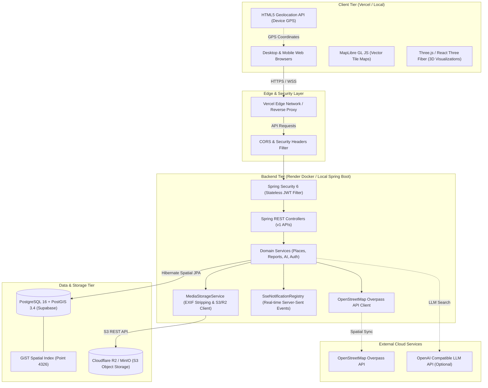
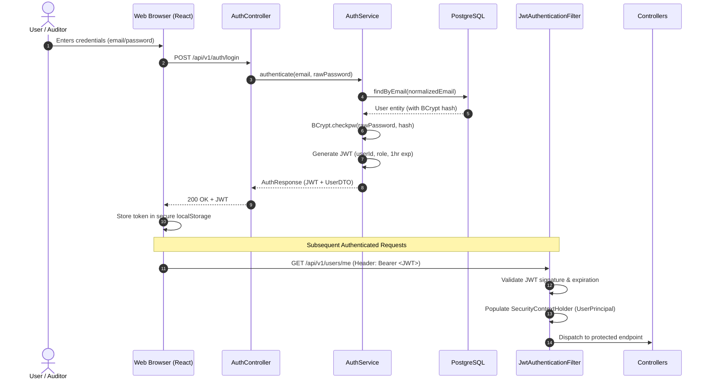
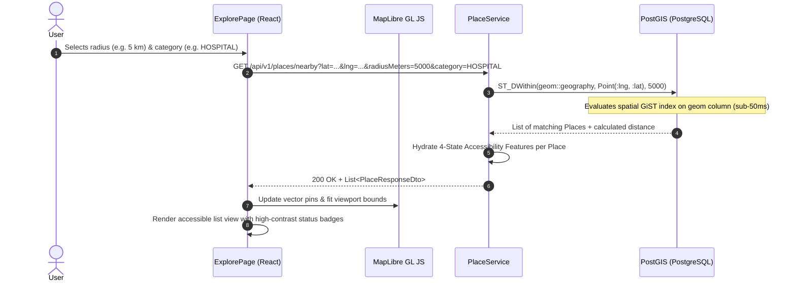
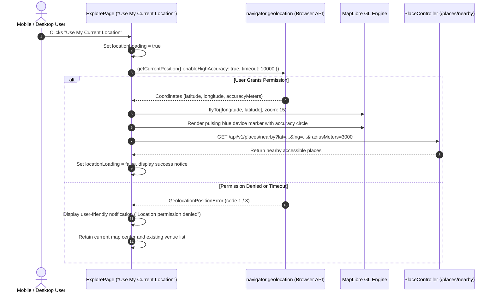

# AccessMap — System Architecture Specification

## 1. System Overview

**AccessMap** is structured as a modern **Modular Monolith** pairing a high-performance **React 18 + TypeScript + Vite** Single Page Application (SPA) with an enterprise **Java 21 + Spring Boot 3** REST API, backed by **PostgreSQL 16 + PostGIS 3.4** and **S3-compatible object storage (Cloudflare R2 / MinIO)**.



---

## 2. Frontend Module Structure

The client application is built with React 18, TypeScript, Tailwind CSS v4, and Vite:

```text
frontend/src/
├── components/
│   ├── 3d/                     # Three.js / React Three Fiber architectural cutaways
│   │   ├── CityHeroScene.tsx            # Isometric 3D landing hero scene
│   │   └── AccessibilityFeature3D.tsx   # Interactive 3D ramp/elevator model with 2D SVG fallback
│   ├── accessibility/          # Accessibility profiles and observation submission modals
│   ├── common/                 # Reusable UI primitives (StatusBadge, ProtectedRoute)
│   ├── dispute/                # Community dispute modals and evidence attachment
│   ├── layout/                 # Shell layouts (Navbar, Footer, PageLayout)
│   ├── map/                    # MapLibre GL JS map instance, layer controls, pins
│   ├── notifications/          # Real-time SSE notification bell and dropdown list
│   ├── profile/                # Avatar photo cropper, zoom controls, and uploader
│   └── report/                 # Community audit modals, camera capture preview
├── context/
│   └── AuthContext.tsx         # Global JWT authentication and user profile state
├── hooks/
│   └── usePrefersReducedMotion.ts  # Detects OS accessibility motion preferences
├── pages/
│   ├── admin/                  # Administrative management pages (Places, Reports, Disputes, Users, Logs)
│   ├── ExplorePage.tsx         # Unified interactive spatial map, nearby places, and category filters
│   ├── HomePage.tsx            # High-contrast hero, features overview, 4-state explainer
│   ├── DashboardPage.tsx       # User profile, mobility preferences, activity history
│   ├── BusinessPage.tsx        # Business owner venue claiming and verified profile management
│   ├── AiAssistantPage.tsx     # Natural language accessibility assistant
│   └── NotificationsPage.tsx   # Notification center and notification settings
├── services/                   # Typed Axios API clients matching backend endpoints
└── types/                      # TypeScript domain models, enums, and API contracts
```

---

## 3. Backend Module Structure

The backend is built as a clean Modular Monolith in Java 21 with Spring Boot 3.4.2:

```text
backend/src/main/java/com/accessmap/
├── ai/                         # Natural language assistant client (OpenAI-compatible & Rule-based fallback)
├── common/                     # Health check controllers and cross-cutting response envelopes
├── config/                     # Spring Security, JWT filters, HikariCP, and CORS configuration
├── controller/                 # 21 REST API controllers (Places, Auth, Reports, Disputes, Admin, etc.)
├── dto/                        # Request/Response Data Transfer Objects with Bean Validation
├── entity/                     # 31 JPA Entities mapped to PostgreSQL tables
├── exception/                  # Global exception handler (@ControllerAdvice) and custom domain exceptions
├── provider/                   # OpenStreetMap Overpass spatial provider and DTOs
├── repository/                 # Spring Data JPA repositories with PostGIS spatial queries
└── service/                    # Core business logic (PlaceService, MediaStorageService, SSERegistry, etc.)
```

---

## 4. Key Runtime Data Flows

### 4.1 Authentication Flow (Stateless JWT)



---

### 4.2 Nearby-Place Spatial Discovery Flow



---

### 4.3 Real-Time Device Phone Location Flow



---

## 5. Security & Boundary Architecture

1. **Stateless Backend:** No HTTP session state is persisted in memory; horizontal scaling across multiple instances requires no sticky sessions.
2. **Strict RBAC:** Role hierarchy is validated at the controller and method level via Spring Security `@PreAuthorize("hasRole('ADMIN')")`.
3. **Database Security:**
   - Password hashes stored strictly as BCrypt (`strength = 12`).
   - SQL queries are executed via JPA parameterized queries preventing SQL injection.
   - PostGIS queries use native types and validated numeric coordinates.
4. **Media Storage Security:**
   - All uploaded photos are transcoded and stripped of EXIF metadata before saving to object storage.
   - Files are stored in private Cloudflare R2 / MinIO buckets with short-lived presigned download URLs or public CDN caching.
5. **Privacy Guard:** Device GPS coordinates are processed exclusively in-memory for proximity query dispatch; user physical locations are never permanently persisted.
