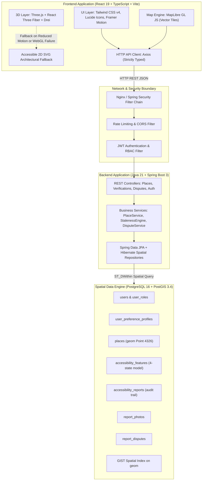
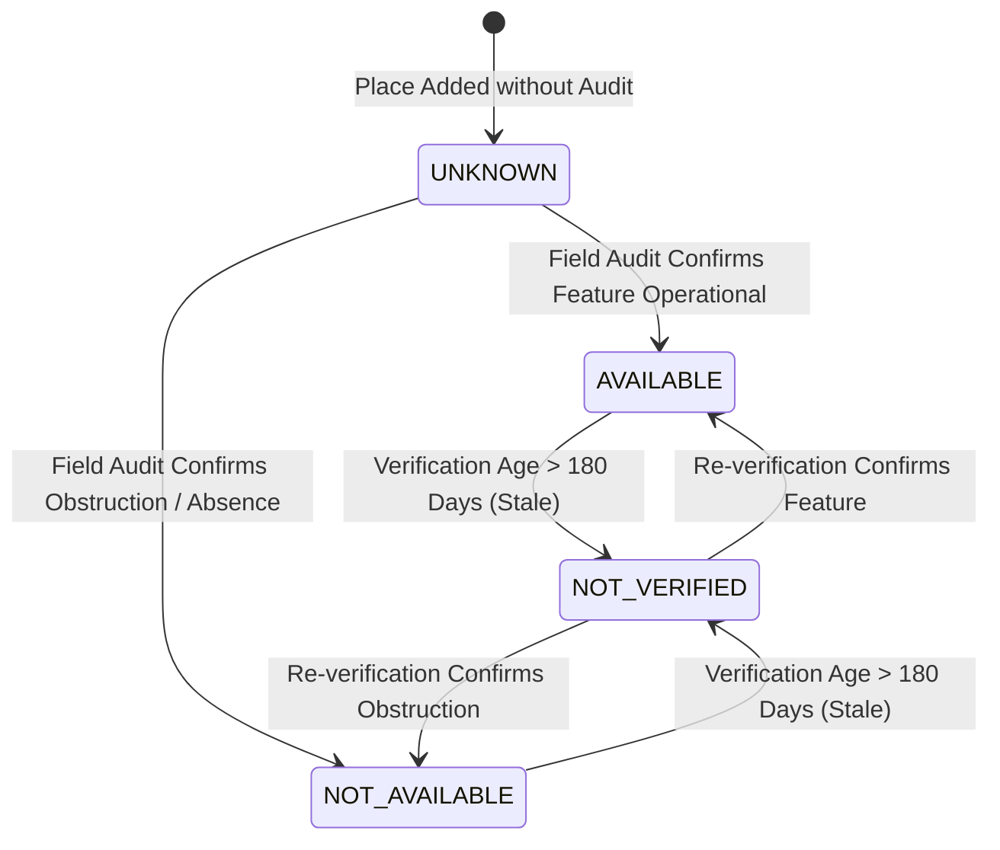
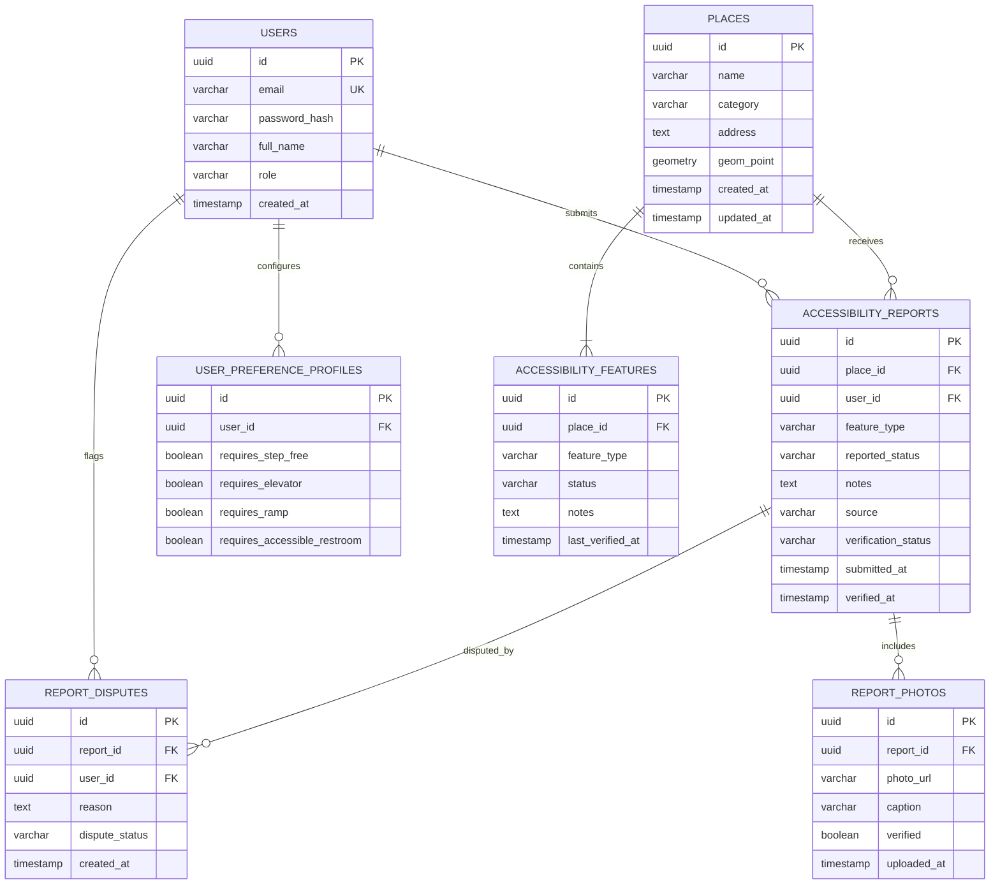

# AccessMap: Technical Architecture Specification

## 1. High-Level System Architecture

AccessMap is engineered as a **Modular Monolith** with a decoupled Single Page Application (SPA) frontend, a containerized PostGIS spatial database, and a robust Java 21 / Spring Boot 3 backend service.



---

## 2. Domain Model & The Four-State Verification State Machine

Accessibility features must never be represented as binary booleans. The domain model enforces four distinct states:



### State Definitions & Rules
1. **`AVAILABLE`**: Verified present and operational within the last 180 days.
2. **`NOT_AVAILABLE`**: Verified absent or non-functional.
3. **`UNKNOWN`**: No audit data recorded yet. **STRICT DOMAIN RULE: `UNKNOWN` is never treated or filtered as `NOT_AVAILABLE`.** It indicates lack of information.
4. **`NOT_VERIFIED`**: Reported by a user but awaiting verification or exceeding the 180-day freshness SLA (`UNVERIFIED_STALE`).

---

## 3. Database Design Plan (PostgreSQL 16 + PostGIS)

### Entity-Relationship Diagram



### Spatial Query Optimization
Spatial searches execute against PostGIS using `ST_DWithin` with geography casts and an optimized GIST index:

```sql
CREATE EXTENSION IF NOT EXISTS postgis;
CREATE INDEX idx_places_geom ON places USING GIST (geom);

-- Example Nearby Places Query (sub-50ms execution)
SELECT id, name, category, address,
       ST_Distance(geom::geography, ST_SetSRID(ST_MakePoint(:lng, :lat), 4326)::geography) AS distance_meters
FROM places
WHERE ST_DWithin(geom::geography, ST_SetSRID(ST_MakePoint(:lng, :lat), 4326)::geography, :radiusMeters)
ORDER BY distance_meters ASC;
```

---

## 4. Frontend Architecture & Progressive 3D Strategy

### 4.1 Component Hierarchy & Dual View
- **Dual View Synchronization:**
  - `MapView` (MapLibre GL JS vector tiles, custom accessibility pins).
  - `PlacesTableView` (Accessible HTML5 table with screen-reader live regions).
  - Both views consume the same reactive state hook (`usePlacesQuery`), ensuring immediate synchronization when panning or filtering.

### 4.2 Progressive 3D Architecture & 2D Fallback (Rule 10)
- **3D Isometric View:** React Three Fiber (`Canvas`) loads lightweight architectural floor cutaways with ramps, entrance doors, and elevator shafts.
- **Dynamic Fallback Pipeline:**
  1. Detects `window.matchMedia('(prefers-reduced-motion: reduce)')`.
  2. Detects WebGL context support or canvas crashes.
  3. Seamlessly swaps in a high-contrast 2D architectural SVG diagram with accessible callouts.

---

## 5. Backend Architecture (Clean Layered Modular Monolith)

### Layer Responsibilities
1. **Controller Layer (`com.accessmap.controller`):**
   - Handles HTTP routing, input validation (`@Valid`), and response formatting.
2. **Service Layer (`com.accessmap.service`):**
   - Enforces business logic:
     - Staleness calculation engine (audits > 180 days -> `NOT_VERIFIED`).
     - Aggregation of venue overall accessibility status.
     - Dispute queue workflow.
3. **Repository Layer (`com.accessmap.repository`):**
   - Spring Data JPA repositories with native PostGIS spatial queries.
4. **Security Filter Chain (`com.accessmap.config.security`):**
   - Stateless JWT authentication filter, CORS configuration, and method-level security (`@PreAuthorize`).

---

## 6. API Communication Standards

All REST endpoints follow strict JSON envelopes:

### Standard Success Response
```json
{
  "success": true,
  "data": {
    "id": "550e8400-e29b-41d4-a716-446655440000",
    "name": "City General Hospital",
    "category": "HOSPITAL",
    "features": [
      {
        "featureType": "STEP_FREE_ENTRANCE",
        "status": "AVAILABLE",
        "lastVerifiedAt": "2026-10-15T09:30:00Z"
      }
    ]
  },
  "timestamp": "2026-11-06T10:25:00Z"
}
```

### Standard Error Response
```json
{
  "success": false,
  "error": {
    "code": "VALIDATION_ERROR",
    "message": "Invalid latitude or longitude coordinates",
    "details": ["latitude must be between -90 and 90"]
  },
  "timestamp": "2026-11-06T10:25:00Z"
}
```

---

## 7. Authentication, Authorization & Security Considerations

### 7.1 Role-Based Access Control (RBAC)
- `ROLE_USER`: Search places, view details, bookmark venues.
- `ROLE_CONTRIBUTOR`: Submit accessibility audits, upload photo proof, submit disputes.
- `ROLE_BUSINESS`: Manage claimed facility profile, submit official facility updates.
- `ROLE_ADMIN`: Review photo queue, resolve disputes, manage categories, inspect audit logs.

### 7.2 Security Defenses
- **Zero Secrets in Git:** Strict `.env` usage; checked against `.gitignore`.
- **SQL & Spatial Injection Prevention:** All spatial operations use parameterized Hibernate Spatial criteria.
- **Strict CORS & CSP:** Restrict origins to authorized frontend domains; deny framing (`X-Frame-Options: DENY`).
- **File Upload Protection:** Validate MIME types (JPEG, PNG, WebP), enforce 5MB maximum file size, and sanitize filenames.
