# AccessMap — Database Architecture & Entity Relationship Specification

## 1. Overview & Spatial Database Design

AccessMap is backed by **PostgreSQL 16** with the **PostGIS 3.4** spatial extension. It utilizes native spatial geometry data types, GiST (Generalized Search Tree) spatial indexing, and relational foreign-key constraints to manage physical accessibility data, community verification trails, and media evidence.

### Core Architectural Principles
1. **Primary Keys:** Every entity uses cryptographically secure UUIDv4 identifiers generated via PostgreSQL `gen_random_uuid()`.
2. **Spatial Geometry:** Venue coordinates are stored in a dedicated `geom` column using `GEOMETRY(Point, 4326)` representing standard WGS84 GPS latitude and longitude.
3. **Sub-50ms Geospatial Indexing:** Spatial columns are indexed using PostGIS **GiST** indexes (`USING GIST (geom)`), enabling high-speed spherical distance calculations (`ST_DWithin`, `ST_Distance`) without full table scans.
4. **Four-State Integrity:** Rather than boolean flags, accessibility feature states are strictly enforced via database `CHECK` constraints across `('AVAILABLE', 'NOT_AVAILABLE', 'UNKNOWN', 'NOT_VERIFIED')`.
5. **Auditability & Traceability:** All community submissions, verifications, and disputes maintain immutable audit logs recording author UUIDs, timestamps, and previous state changes.

---

## 2. Mermaid Entity Relationship (ER) Diagram

```mermaid
erDiagram
    USERS ||--o| USER_PREFERENCE_PROFILES : "has profile"
    USERS ||--o{ ACCESSIBILITY_REPORTS : "submits"
    USERS ||--o{ REPORT_DISPUTES : "raises"
    USERS ||--o{ NOTIFICATIONS : "receives"
    USERS ||--o{ NOTIFICATION_PREFERENCES : "configures"
    USERS ||--o{ PLACE_OWNERSHIPS : "claims"
    USERS ||--o{ MEDIA_FILES : "uploads"
    USERS ||--o{ ADMIN_AUDIT_LOGS : "performs"

    PLACES ||--o{ ACCESSIBILITY_FEATURES : "has features"
    PLACES ||--o{ ACCESSIBILITY_REPORTS : "receives reports"
    PLACES ||--o{ PLACE_OWNERSHIPS : "owned by"
    PLACES ||--o{ ACCESSIBILITY_AUDIT_LOGS : "logs changes"

    FEATURE_DEFINITIONS ||--o{ ACCESSIBILITY_FEATURES : "defines type"

    ACCESSIBILITY_REPORTS ||--o{ REPORT_PHOTOS : "contains evidence"
    ACCESSIBILITY_REPORTS ||--o{ REPORT_DISPUTES : "subject of"
    ACCESSIBILITY_REPORTS ||--o{ REVIEW_ASSIGNMENTS : "assigned to"

    REPORT_DISPUTES ||--o{ DISPUTE_PHOTOS : "attaches proof"
    REPORT_DISPUTES ||--o{ MODERATION_ACTIONS : "triggers action"

    USERS {
        uuid id PK
        varchar email UK
        varchar password_hash
        varchar full_name
        varchar role
        varchar avatar_url
        boolean is_enabled
        timestamp created_at
        timestamp updated_at
    }

    USER_PREFERENCE_PROFILES {
        uuid id PK
        uuid user_id FK
        boolean requires_step_free_entrance
        boolean requires_elevator
        boolean requires_ramp
        boolean requires_accessible_restroom
        boolean requires_accessible_parking
        timestamp created_at
    }

    PLACES {
        uuid id PK
        varchar name
        varchar category
        text address
        varchar city
        varchar country
        geometry geom "Point 4326 GiST"
        varchar phone
        varchar website
        varchar osm_id
        varchar osm_type
        varchar verified_status
        boolean is_active
        timestamp created_at
        timestamp updated_at
    }

    FEATURE_DEFINITIONS {
        uuid id PK
        varchar code UK
        varchar name
        varchar category
        text description
        varchar icon
        int weight
    }

    ACCESSIBILITY_FEATURES {
        uuid id PK
        uuid place_id FK
        varchar feature_type
        varchar status "AVAILABLE | NOT_AVAILABLE | UNKNOWN | NOT_VERIFIED"
        text notes
        timestamp last_verified_at
    }

    ACCESSIBILITY_REPORTS {
        uuid id PK
        uuid place_id FK
        uuid submitted_by FK
        varchar feature_type
        varchar reported_status
        varchar source "USER | CONTRIBUTOR | BUSINESS_OWNER | ADMIN | IMPORT"
        varchar verification_status "PENDING | VERIFIED | REJECTED | STALE"
        int upvotes
        int downvotes
        text notes
        timestamp submitted_at
        timestamp verified_at
    }

    REPORT_PHOTOS {
        uuid id PK
        uuid report_id FK
        varchar photo_url
        varchar caption
        boolean is_verified
        timestamp uploaded_at
    }

    REPORT_DISPUTES {
        uuid id PK
        uuid report_id FK
        uuid raised_by FK
        varchar category
        text reason
        varchar dispute_status "OPEN | RESOLVED | DISMISSED"
        text resolution_notes
        timestamp created_at
        timestamp resolved_at
    }

    DISPUTE_PHOTOS {
        uuid id PK
        uuid dispute_id FK
        varchar photo_url
        varchar caption
        timestamp uploaded_at
    }

    MEDIA_FILES {
        uuid id PK
        varchar file_name
        varchar content_type
        bigint file_size
        varchar storage_provider
        varchar storage_key
        varchar public_url
        uuid uploaded_by FK
        timestamp created_at
    }

    NOTIFICATIONS {
        uuid id PK
        uuid user_id FK
        varchar title
        text message
        varchar type
        boolean is_read
        varchar link
        timestamp created_at
    }

    NOTIFICATION_PREFERENCES {
        uuid id PK
        uuid user_id FK
        boolean email_notifications
        boolean in_app_notifications
        boolean report_updates
        boolean dispute_alerts
    }

    PLACE_OWNERSHIPS {
        uuid id PK
        uuid place_id FK
        uuid user_id FK
        varchar claim_status "PENDING | APPROVED | REJECTED"
        varchar verification_document_url
        timestamp claimed_at
        timestamp verified_at
    }

    ACCESSIBILITY_AUDIT_LOGS {
        uuid id PK
        uuid place_id FK
        varchar feature_type
        varchar old_status
        varchar new_status
        uuid changed_by FK
        text reason
        timestamp created_at
    }

    ADMIN_AUDIT_LOGS {
        uuid id PK
        uuid admin_id FK
        varchar action
        varchar target_type
        varchar target_id
        text details
        varchar ip_address
        timestamp created_at
    }

    PLATFORM_SETTINGS {
        uuid id PK
        varchar setting_key UK
        text setting_value
        text description
        timestamp updated_at
        uuid updated_by FK
    }

    DATA_IMPORT_HISTORY {
        uuid id PK
        varchar source
        int records_imported
        int records_failed
        varchar status
        text error_log
        timestamp imported_at
    }
```



---

## 3. Spatial Query & PostGIS Implementation Details

### 3.1 Proximity Radius Query (`ST_DWithin`)
All radius searches are executed natively in the database using the PostGIS `ST_DWithin` spatial predicate cast to a geography sphere (meters):

```sql
SELECT p.*,
       ST_Distance(p.geom::geography, ST_SetSRID(ST_MakePoint(:lng, :lat), 4326)::geography) AS distance_meters
FROM places p
WHERE p.is_active = TRUE
  AND ST_DWithin(p.geom::geography, ST_SetSRID(ST_MakePoint(:lng, :lat), 4326)::geography, :radiusMeters)
ORDER BY distance_meters ASC
LIMIT :limit OFFSET :offset;
```

### 3.2 Bounding Box Map Viewport Query (`ST_MakeEnvelope`)
When users pan or zoom on the MapLibre GL map, the frontend sends the viewport bounding box `[minLng, minLat, maxLng, maxLat]`:

```sql
SELECT p.*
FROM places p
WHERE p.is_active = TRUE
  AND p.geom && ST_MakeEnvelope(:minLng, :minLat, :maxLng, :maxLat, 4326);
```

### 3.3 Multi-Feature Availability Filtering
Places can be filtered by requiring specific accessibility features to be `AVAILABLE`:

```sql
SELECT p.*
FROM places p
WHERE p.is_active = TRUE
  AND p.id IN (
      SELECT af.place_id
      FROM accessibility_features af
      WHERE af.feature_type IN (:requiredFeatures)
        AND af.status = 'AVAILABLE'
      GROUP BY af.place_id
      HAVING COUNT(DISTINCT af.feature_type) = :featureCount
  );
```

---

## 4. Database Indexing Strategy

| Table | Index Name | Type | Indexed Columns / Predicate | Purpose |
| :--- | :--- | :---: | :--- | :--- |
| `places` | `idx_places_geom` | **GiST** | `geom` | Enables sub-50ms geospatial proximity and bounding box calculations |
| `places` | `idx_places_category` | B-Tree | `category` | High-speed category filtering (Hospital, Transit, College, etc.) |
| `places` | `idx_places_active` | B-Tree | `is_active` | Soft deletion and active state filtering |
| `accessibility_features` | `uq_place_feature` | Unique B-Tree | `(place_id, feature_type)` | Prevents duplicate feature entries per place |
| `accessibility_features` | `idx_features_status` | B-Tree | `status` | Rapid feature status lookups |
| `users` | `idx_users_email` | Unique B-Tree | `email` | Instant authentication lookups by normalized email |
| `accessibility_reports` | `idx_reports_place_id` | B-Tree | `place_id` | Aggregates community audits for venue details |
| `accessibility_reports` | `idx_reports_status` | B-Tree | `verification_status` | Moderation queue retrieval (`PENDING`) |
| `notifications` | `idx_notifications_user` | B-Tree | `(user_id, is_read)` | Fast unread badge counting and alerts loading |

---

## 5. Schema Migration History

Schema changes are tracked version-by-version using Flyway:

- `V1__initial_schema.sql`: Core users, places with PostGIS `Point 4326`, accessibility features, reports, report photos, disputes.
- `V2__seed_places.sql`: Seed dataset with realistic hospital, college, transit, restaurant, and civic venues.
- `V3__place_accessibility_and_verifications.sql`: Detailed feature definitions and verification rules.
- `V4__update_user_roles.sql`: RBAC roles (`ROLE_USER`, `ROLE_CONTRIBUTOR`, `ROLE_BUSINESS`, `ROLE_ADMIN`).
- `V5__extend_places_table.sql`: Operating hours, phone, website, and metadata fields.
- `V6__accessibility_profiles_and_verification.sql`: User preference profiles and mobility indicators.
- `V7__expand_place_categories_and_osm_provenance.sql`: OpenStreetMap provenance fields (`osm_id`, `osm_type`).
- `V8__media_files_and_user_avatars.sql`: `media_files` table and user avatar storage mapping.
- `V9__accessibility_audit_log_and_enhancements.sql`: `accessibility_audit_logs` tracking status change histories.
- `V10__community_accessibility_reports.sql`: Enhanced upvoting and community auditing structure.
- `V11__advanced_verification_and_disputes.sql`: Detailed dispute categories, dispute photos, and review assignments.
- `V12__admin_dashboard_and_platform_management.sql`: `admin_audit_logs`, `platform_settings`, and `data_import_history`.
- `V13__notifications_and_realtime_updates.sql`: `notifications`, `notification_preferences`, and real-time SSE support.
