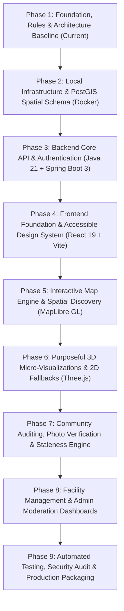

# AccessMap: Phased Implementation Roadmap

This roadmap breaks down the construction of **AccessMap** into incremental, independently testable phases and milestones. In alignment with our engineering rules, development proceeds sequentially through defined checkpoints with honest, real command verification.

---

## Roadmap Overview

---

## Phase 1: Project Foundation, Architecture Baseline & Environment Audit
**Status:** In Progress (Current)

### Objectives
- Establish the independent workspace directory for `AccessMap` separate from all other projects.
- Audit developer workstation prerequisites (Java 21, Node.js, npm, Docker, Git).
- Establish core software engineering rules, accessible UX standards, and security mandates.
- Author comprehensive specifications: `PROJECT_RULES.md`, `REQUIREMENTS.md`, `ROADMAP.md`, `ARCHITECTURE.md`.
- Configure repository baseline: `.gitignore`, `README.md`, `docker-compose.yml`.

### Deliverables
- `AccessMap/` root directory with `frontend/`, `backend/`, and `docs/`.
- `docs/PROJECT_RULES.md`, `docs/REQUIREMENTS.md`, `docs/ROADMAP.md`, `docs/ARCHITECTURE.md`.
- `docker-compose.yml` (PostGIS 16 spatial container definition).
- `README.md` and `.gitignore`.

### Verification Criteria
- [x] Workspace verified as completely independent of `AgroAI-main`.
- [x] All 4 documentation files populated with complete, detailed technical content.
- [x] No dependencies installed or application code initialized prematurely.
- [ ] User review and approval received before proceeding to Phase 2.

---

## Phase 2: Local Infrastructure & PostGIS Spatial Database
**Target Tech:** Docker Compose, PostgreSQL 16, PostGIS 3.4, SQL Migration Scripts

### Objectives
- Configure containerized spatial database infrastructure using Docker Compose.
- Initialize PostgreSQL schema with PostGIS extension (`CREATE EXTENSION IF NOT EXISTS postgis;`).
- Implement relational tables with spatial Point geometry (`GEOMETRY(Point, 4326)`):
  - `users` and `roles` (RBAC data structures).
  - `user_preference_profiles` (mobility preference filters).
  - `places` (coordinates, venue categories, address metadata).
  - `accessibility_features` (4-state tracking per feature).
  - `accessibility_reports` (source, timestamps, notes).
  - `report_photos` (metadata, verified flag).
  - `report_disputes` (flagging and resolution workflow).
- Create spatial `GIST` indexes for sub-50ms proximity queries.
- Write realistic seed migrations for sample venues (hospitals, colleges, transit hubs, restaurants).

### Deliverables
- `docker-compose.yml` operational with health checks and persistent volume.
- Versioned SQL migrations (`V1__initial_schema.sql`, `V2__seed_places.sql`).
- `.env.example` template for database credentials.

### Verification Criteria
- `docker compose up -d` starts cleanly and reports healthy status.
- `SELECT PostGIS_Full_Version();` executes successfully.
- Seed data queried via spatial proximity function (`ST_DWithin`) returns expected results.

---

## Phase 3: Backend Core API & Authentication (Modular Monolith)
**Target Tech:** Java 21, Spring Boot 3, Spring Data JPA, Hibernate Spatial, Spring Security, Maven

### Objectives
- Initialize clean Spring Boot 3 modular monolith inside `/backend` with Maven wrapper (`mvnw`).
- Model JPA entities (`Place`, `AccessibilityFeature`, `User`, `AccessibilityReport`, `Dispute`) with spatial types.
- Implement Spring Security with stateless JWT filter chain and Role-Based Access Control.
- Build the core REST APIs:
  - `POST /api/v1/auth/register`, `POST /api/v1/auth/login`.
  - `GET /api/v1/places` (paginated filtering by category & feature).
  - `GET /api/v1/places/nearby?lat=...&lng=...&radiusMeters=...` (PostGIS spatial queries).
  - `GET /api/v1/places/{id}` (full details with 4-state feature breakdown).
- Implement the Staleness Engine (computing `NOT_VERIFIED` / `UNVERIFIED_STALE` when > 180 days).
- Author automated JUnit 5 and MockMvc tests.

### Deliverables
- Fully compilable Spring Boot backend in `/backend`.
- Clean layered architecture: Controller, Service, Repository, DTO, Entity.
- Automated test suite.

### Verification Criteria
- `./mvnw clean test` (or `mvnw.cmd clean test`) compiles and passes all tests.
- MockMvc tests verify 4-state rule: `UNKNOWN` is never serialized as `NOT_AVAILABLE`.

---

## Phase 4: Frontend Foundation & Accessible Design System
**Target Tech:** React 19, TypeScript, Vite, Tailwind CSS v4, Lucide React, React Router DOM v6

### Objectives
- Initialize React + TypeScript application with Vite inside `/frontend`.
- Configure Tailwind CSS v4 with custom high-contrast design system (deep navy, emerald/teal, high-contrast text).
- Build the responsive accessible application shell:
  - `SkipLink` for keyboard navigation.
  - Semantic `<header>`, `<nav>`, `<main>`, `<footer>` landmarks.
  - Active focus rings with visible `:focus-visible` styling.
- Create domain types and reusable UI components:
  - `StatusBadge` implementing the 4-state verification model with icons, text, and ARIA labels.
  - Accessibility preference toggle controls.
- Construct the interactive Landing Page showcasing the platform value proposition.

### Deliverables
- `/frontend` application configured and type-checked (`tsc --noEmit`).
- Accessible design system components.
- Landing page with responsive layouts.

### Verification Criteria
- `npm run build` succeeds without TypeScript or bundler errors.
- Accessible navigation verified using keyboard traversal (`Tab` / `Enter` / `Space`).

---

## Phase 5: Interactive Map Engine & Spatial Discovery
**Target Tech:** MapLibre GL JS, React, TypeScript, Axios

### Objectives
- Integrate MapLibre GL JS with high-contrast, accessible vector tile styling.
- Render dynamic accessibility pins colored by aggregate venue accessibility.
- Implement viewport synchronization: Panning/zooming queries nearby places within the bounding box.
- Build Dual-View Mode: Accessible toggle between the interactive map view and a screen-reader-friendly table/list view.
- Connect frontend to backend spatial endpoints via typed Axios client.

### Deliverables
- `MapView` and `PlaceCard` components with smooth viewport interaction.
- Accessible `PlacesTableView` for assistive technology users.
- Filter drawer for category, radius, and required features.

### Verification Criteria
- Map renders without WebGL errors or memory leaks.
- Proximity search updates place results in under 150ms.
- Screen readers announce place card results accurately in dual-view mode.

---

## Phase 6: Purposeful 3D Micro-Visualizations & Resilient Fallbacks
**Target Tech:** Three.js, React Three Fiber (R3F), `@react-three/drei`

### Objectives
- Build an interactive 3D isometric building cutaway visualizing multi-level accessibility:
  - Entrance ramp gradient and step-free access doors.
  - Elevator core vs. stairways across vertical floors.
  - Accessible restroom location on floor plans.
- Implement strict progressive enhancement:
  - Detect `prefers-reduced-motion`: Automatically disable auto-rotation and camera tweens.
  - Fallback engine: If WebGL is unsupported or lost, render a clean, accessible 2D architectural SVG diagram.

### Deliverables
- `AccessibilityCutaway3D` component with interactive floor-level toggles.
- `ArchitecturalDiagram2D` fallback SVG component.
- Reduced-motion hook (`usePrefersReducedMotion`).

### Verification Criteria
- 3D cutaway renders smoothly at 60 FPS on supported hardware.
- Emulated `prefers-reduced-motion` in browser DevTools immediately switches view to 2D SVG fallback.

---

## Phase 7: Community Auditing, Photo Evidence & Staleness Engine
**Target Tech:** Spring Boot REST, Multi-part File Upload, React Forms

### Objectives
- Build community audit reporting flow: Contributors submit status updates on monitored features.
- Support photo evidence attachment with secure server-side validation (MIME type, file size limit).
- Implement dispute submission: Users can flag incorrect or outdated data.
- Wire up the 180-day staleness countdown indicators on frontend place details.

### Deliverables
- `AuditSubmissionModal` and `PhotoUploadZone` components.
- Backend file storage handler with virus/MIME validation.
- Audit history timeline component on venue detail pages.

### Verification Criteria
- Contributors can submit audits with photos; status updates immediately reflect on place view.
- Stale reports older than 180 days automatically show `NOT_VERIFIED` badge.

---

## Phase 8: Business & Facility Dashboards & Admin Moderation
**Target Tech:** React Router, Spring Security RBAC, Recharts / Dashboard Layouts

### Objectives
- Construct Business Facility Dashboard:
  - Venue claiming workflow.
  - Facility managers can post scheduled maintenance alerts (e.g., "Elevator modernization").
  - Official business verification badges.
- Construct Admin Moderation Dashboard:
  - Pending photo evidence moderation queue.
  - Dispute resolution workflow (accept dispute, request re-audit, dismiss).
  - System telemetry: Total audited places, verified percentages, active contributors.

### Deliverables
- Role-protected routes in React for `/business` and `/admin`.
- Moderation workflow UI with approval and dispute resolution buttons.
- System health and metric dashboard widgets.

### Verification Criteria
- Non-admin users attempting to access `/admin` receive HTTP 403 Forbidden.
- Approving a dispute updates the venue's feature state and generates an audit log entry.

---

## Phase 9: Automated Testing, Security Audit & Production Packaging
**Target Tech:** Vitest, Testing Library, JUnit 5, Docker Compose Multi-Stage Builds, OWASP Check

### Objectives
- Execute full test automation:
  - Backend unit and MockMvc integration tests.
  - Frontend component and accessibility tests (`axe-core`).
- Comprehensive security audit:
  - CORS, CSP, X-Content-Type-Options headers.
  - SQL/spatial parameterization verification.
  - Rate limiting on public submission endpoints.
- Package application for production:
  - Multi-stage Dockerfiles for backend JAR and frontend Nginx static container.
  - Final end-to-end integration test with Docker Compose.

### Deliverables
- Production-ready `Dockerfile.backend` and `Dockerfile.frontend`.
- Complete test reports with real, honest execution outputs.
- Deployment runbook.

### Verification Criteria
- 100% automated test pass rate with zero fabricated results.
- Production containers build and run cleanly via `docker compose -f docker-compose.prod.yml up`.
